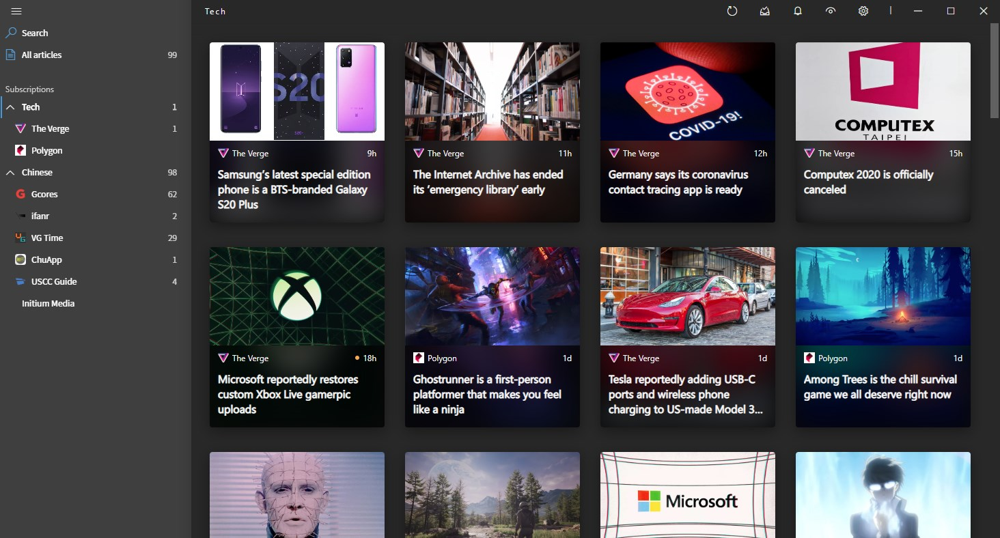
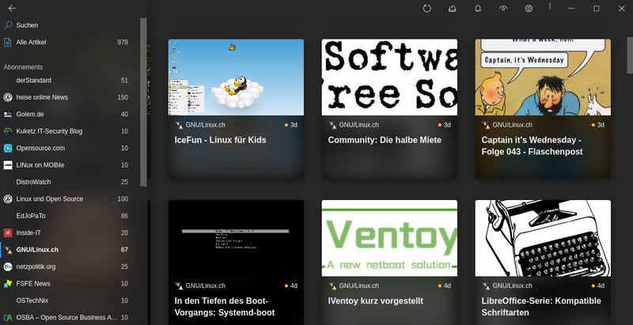

# Fluent Reader for Organized Desktop RSS Reading

[](https://github.com/fluent-reader-rss/fluent-reader/releases/)

Fluent Reader brings subscribed sources into a desktop news-reading workspace.
It combines local reading with optional connections to compatible RSS services.
The desktop application is built with Electron, React and Fluent UI.

## Reading and Organisation

Choose a reading mode according to the content supplied by each source.
A feed can contain complete articles, short summaries or links to a publisher's page.

| Mode | What it displays | Useful situation |
| --- | --- | --- |
| Built-in article view | Content provided through the feed | Reading without the publisher's page layout |
| Full-content extraction | Article text retrieved with Mercury Parser | A source supplies only a short excerpt |
| Embedded webpage | The publisher's page inside the application | Content depends on the original layout |
| External browser | The article at its original location | Continuing with normal browser tools |

A failed extraction and a failed feed refresh are different problems.
Compare the feed content with the source page before changing synchronisation settings.
Some publishers provide material that an extractor cannot recover completely.



### Subscription Groups

Folder-like groups organise sources around a topic or reading routine.
Use a manageable set of groups so incoming updates remain easy to review.
Keep source names recognisable when several publications cover the same subject.

### Article States

Read status, stars and hidden status serve different purposes.
A star can identify an article to revisit.
Hiding an article removes it from the ordinary reading flow.

### Display Preferences

Fluent Reader supports dark presentation for both the interface and reading content.
Select the view that fits your screen and article length.
The v1.3.2 release adds resizable article areas in overlay and split-pane layouts.

## Local Reading and Service Sync

Fluent Reader RSS workflows can use local subscriptions or a remote account.
These modes have different responsibilities for storing and synchronising state.
Identify the active mode before diagnosing an account problem.

### Local Sources

OPML import provides a way to bring a subscription list into the application.
Sources can also be organised and read without a remote RSS service.
Local reading still requires network access when fetching new feed content.

### Compatible Services

The project documents Inoreader and Feedbin integrations.
It also supports services implementing the Fever or Google Reader API.
The Old Reader and BazQux Reader are among the documented service options.

Service compatibility depends on the API endpoint and account configuration.
A working website login does not by itself verify API access.
Keep service credentials out of screenshots and issue reports.

### Checking a Sync Problem

1. Confirm the selected service and account.
2. Refresh one recognisable source.
3. Compare an article's state with the service interface.
4. Record whether the problem affects fetching or state changes.

A local subscription and a service subscription can refer to the same feed URL.
Review the documented account-transition behavior before connecting an existing local collection.
Do not assume that changing account mode preserves every locally cached article.

## Search and Regular Expression Rules

Search can use regular expressions to locate matching articles.
Source-specific rules can apply actions as incoming articles are processed.
Rules run in sequence, so later actions can affect earlier results.

### Testing a Pattern

Start with sample titles that should match and titles that should remain unchanged.
The following standalone JavaScript example checks two topic words.
It illustrates the expression rather than an application configuration file.

```javascript
const titles = ["Security bulletin", "Release notes", "Weekly summary"];
const pattern = /security|release/i;
for (const title of titles) {
  console.log(pattern.test(title), title);
}
```

For an application rule, enter the expression text without JavaScript delimiters.
Use matching case settings when comparing the sample with the application.
Test the rule against representative title and content text before choosing its actions.

### Rule Actions

- Star selected items for later review.
- Mark matching items as read where appropriate.
- Hide material that should leave the normal reading list.
- Use notification actions with background fetching.

## OPML and Application Backups

OPML describes subscriptions and their grouping.
It should not be treated as a complete copy of application data.
Fluent Reader provides a separate full-data backup and restoration workflow.

### Moving Between Computers

Keep the subscription list and a full backup distinguishable.
Choose the appropriate transfer method for the state you want to preserve.
Verify the restored collection before replacing an existing working setup.

### Desktop and Mobile

Fluent Reader desktop is separate from Fluent Reader Lite.
The mobile counterpart has its own codebase and release numbering.
Service configuration can be exported to Lite through the documented QR-code workflow.



## Requirements

The packaged desktop application includes its Electron runtime.
Running it does not require a PHP server or a separately configured SQL server.
A connected self-hosted RSS service has its own independent server requirements.

| Platform or task | Relevant requirement | Detail to check |
| --- | --- | --- |
| Windows package | Compatible Windows desktop and package architecture | v1.3.2 release assets include x64 installer and ZIP packages |
| macOS package | macOS 13 or later in the v1.3.2 packaging configuration | Match the release package to the Mac |
| Linux package | Compatible x64 Linux environment | The release provides an AppImage |
| Source development | Node.js, npm and platform build support | Match dependency requirements to the selected tag |
| Native dependencies | Electron-compatible native modules | Installation can require platform build tools |

## Build from Source

The example assumes a complete Fluent Reader source checkout.
Run it from the source root with a compatible Node.js environment.
Dependency installation also prepares Electron application dependencies.

```bash
npm install
npm run build
npm run electron
```

The build script compiles application resources through webpack.
The Electron script launches the compiled desktop entry point.
These commands are documentation examples and have not been executed here.

### Windows Packaging

This independent example follows the Windows release workflow.
The packaging script targets x64 and disables automatic publishing.
Run it on an appropriately configured Windows development system.

```bash
npm install
npm run build
npm run package-win-ci
```

Packaging and publisher signing are separate responsibilities.
Store-oriented APPX packaging uses a different project script.
A locally generated certificate does not establish the official publisher's identity.

## Privacy and Connected Content

The publisher states that the application does not collect personal information.
The documented cookie session is temporary and ends when the application closes.
A connected RSS service can still observe activity submitted through its API.

Article extraction and webpage loading contact external content sources.
Choose a reading mode with that network behavior in mind.
Local storage does not make every content request local.

## Development and Release Identification

Fluent Reader is open source under the BSD 3-Clause license.
Use the selected release tag when reproducing a reported issue.
Desktop and Lite versions should be identified separately.

A useful issue report names the platform, application version and affected source.
Include the reading mode or connected service when relevant.
Remove account secrets and private feed addresses from shared diagnostics.

## Related Search Terms

fluent reader, fluent reader rss, fluent reader desktop, fluent reader open source, fluent reader linux, electron, linux, macos, react, rss, rss-reader, typescript, windows, aggregator, feed-reader
